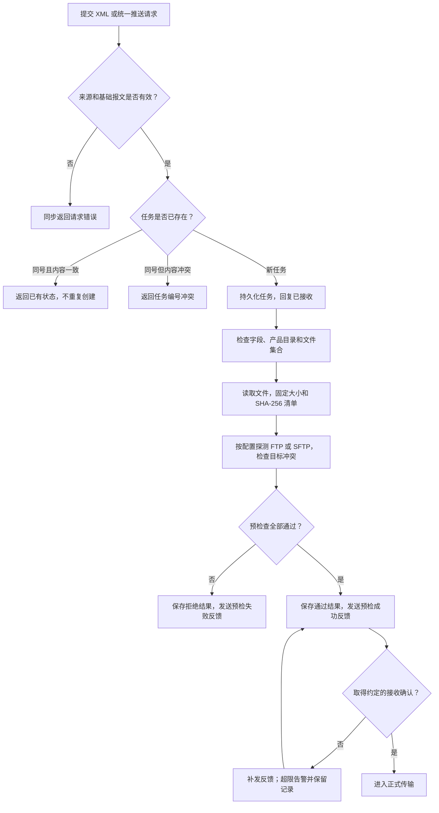
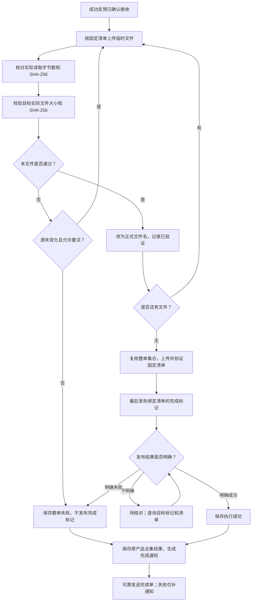

# 数据共享平台：推送流程

| 文档信息 | 内容 |
| --- | --- |
| 版本 | V1.1 |
| 日期 | 2026-11-13 |
| 状态 | 设计稿；新增对接规则需在双方联调中落定 |
| 适用范围 | 原 XML 入口或统一任务入口提交推送任务，共享平台将本地产品推送到配置的 FTP 或 SFTP 远端 |
| 配套文档 | [事实需求依据](00_事实需求依据.md)、[拉取流程](02_拉取流程.md)、[边界约定](03_边界约定.md) |

V1.1 增补 FTP/SFTP 可配置服务列表、统一任务入口、协议差异、配置页面和任务进度展示的衔接。原 XML 的三类单据继续保留。Java 和不前后端分离属于用户约束；服务端页面与 API 由同一应用提供是当前架构建议，具体框架尚未选定。

## 1. 目标、依据与保证范围

共享平台接收任务后，检查请求、源产品和目标链路，生成固定的传输清单；逐文件上传并核对目标实际内容；全部产品通过后发布整单成果，向业务平台发送完成单。

本文以用户提供的《2.1 调度系统与数据云共享子系统接口设计》及后续补充需求为依据，事实来源统一见[事实需求依据](00_事实需求依据.md)。任务通知单、`doAsk`、`doComplete` 以及原有 XML 字段和状态来自原接口文档。可配置 FTP/SFTP 服务列表、按两种协议推送或拉取、多个监听目标、配置页及服务与进度展示、Java 且不前后端分离，来自用户新增要求。产品目录含义、统一入口具体 URL 和报文、路由规则、传输清单、严格校验、完成标记、重试及 ACK 细节属于本次设计，不能当作对方已经支持或用户已经确认了全部细节的既有能力。

**本方案保证：在生产方固定源版本、目标任务目录受控、接收方遵守发布规则的前提下，预检查固定的文件集合及目录结构完整交付，目标文件字节内容与固定基准一致。**

共享平台自行生成的是“传输清单”。没有生产方应交付清单或产品结构规则时，不能据此发现上游本来应生成却未生成的文件。影像内容、业务范围及其他业务质量由业务平台验收。

## 2. 首版数据与目录规则

| 项目 | 规则 | 来源 |
| --- | --- | --- |
| `product` | 一个节点代表一个数据包 | 原接口 |
| 产品实体 | 首版统一为一个产品目录；单个 ZIP、TIFF 等文件也放在产品目录内 | 补充规则 |
| `fileCount` | 产品包数量，必须等于本任务 `product` 节点数量 | 原接口的包级计数口径 |
| `productPath` | 任务通知单中表示产品目录相对于源数据根目录的路径 | 补充规则 |
| `productName` | 产品显示名称，不参与文件路径拼接 | 补充规则 |
| 推送范围 | 递归纳入产品目录中的普通文件，记录并保留目录结构；符号链接和特殊文件拒绝接收 | 补充规则 |
| 源数据就绪 | 下发任务代表生产方确认该版本已生成完成；任务处理期间不得增删、修改这一版源数据 | 补充规则 |
| 传输协议 | 支持配置的 FTP 和 SFTP 两种远端连接 | 用户补充要求 |
| 远端连接引用 | 用 `endpointId` 引用已配置、启用且调用方有权使用的远端连接；请求不直接携带明文远端凭据 | 补充规则 |
| XML 配置选择 | 通过已鉴权的来源系统及产品 `type` 唯一匹配路由，路由关联 `endpointId` | 补充规则 |
| 统一入口配置选择 | 建议请求指定 `direction=PUSH` 和 `endpointId`；本地源根目录仍由允许的配置确定 | 补充规则 |
| 目标隔离 | 使用独立任务目录，避免不同任务相互覆盖 | 补充规则 |
| 数据处理 | 按复制交付，源数据保留；源数据清理另行约定 | 补充规则 |

### 2.1 路径映射

| 对象 | 组成 |
| --- | --- |
| 实际源产品目录 | `sourceRoot + productPath` |
| 目标任务目录 | `targetRoot/sourceCode/taskId/` |
| 目标产品目录 | `targetRoot/sourceCode/taskId/productId/` |
| 目标业务文件 | `targetRoot/sourceCode/taskId/productId/relativePath` |
| 目标传输清单 | `targetRoot/sourceCode/taskId/_manifest.xml` |
| 目标完成标记 | `targetRoot/sourceCode/taskId/_READY` |

`relativePath` 相对于源产品目录。控制文件放在任务根目录，与产品目录分开，防止控制文件和业务文件重名。用于路径的各标识必须经过安全字符验证或稳定、无碰撞的编码，保存编码前后映射，不能随意截断标识。

完成单中的 `productPath` 建议返回已分配目标产品目录相对于 `targetRoot` 的路径，即 `sourceCode/taskId/productId/`。失败完成单中的路径只用于定位和诊断，不表示该目录的数据可消费。此含义属于新增对接约定。

### 2.2 路由与源版本固定

任务保存本次 `endpointId`、连接配置版本、协议类型、源根目录、目标主机和端口、目标根目录、校验方式及通知配置引用。SFTP 还记录本次使用的可信主机密钥配置版本。执行中不跟随其他配置改变协议或目的地。凭据使用受控引用，不将密码、私钥写入清单或日志。

源冻结首先是生产方的交付承诺；共享平台通过目录复查、文件属性检查、上传读取哈希来发现变化。稳定一段时间、文件能够打开或取得某种文件锁，都不能单独证明生产结束。生产方无法保证冻结时，应先提供独立的固定版本交付目录。

### 2.3 两种入口共用执行链

| 入口 | 目标选择 | 标准化后的处理 |
| --- | --- | --- |
| 原任务通知单 XML | 来源系统＋`type` 匹配路由，再取得 `endpointId` | 保留原报文与字段语义，进入统一预检查、传输、核验、发布链 |
| 统一任务入口 | 建议由 `direction=PUSH` 和 `endpointId` 明确方向与目标连接 | 将请求转换为相同的任务、产品和通知上下文，再进入同一执行链 |

统一入口建议为 `POST /api/transfers/tasks`；此 URL、具体内容类型和字段结构是设计建议，仍需接口设计落定。建议字段包括 `taskId`、`direction`、`endpointId`、产品类别及产品列表。产品信息继续使用产品 ID、名称和源相对路径的概念。`endpointId` 决定使用 FTP 还是 SFTP，请求不能用另一个协议字段临时覆盖连接配置。

统一入口按 `direction` 分派业务：本文定义 `PUSH` 分支，`PULL` 分支见[拉取流程](02_拉取流程.md)；原 XML 任务通知单固定映射为推送任务。

**幂等键跨入口统一为“来源系统＋taskId”。** 比较标准化后的方向、产品业务内容和目标连接。相同任务从 XML 入口与统一入口重复提交，不创建第二条传输任务；方向、目标或产品内容冲突则拒绝。已有 XML 任务使用其保存的路由快照解释目标连接，不能因配置后来变化而重定向同一任务。

两个入口均绑定调用方的通知配置，保持预检查反馈和完成通知。原 XML 入口必须使用原 `doAsk`、`doComplete` 单据；统一入口的通用通知报文属于待约定内容。首版设计继续按预检反馈确认后执行的顺序处理，是否采用不同 ACK 时序须明确约定。任务查询及页面展示用于补充查看和故障核对，不替代反馈闭环。

## 3. 预检查流程图



预检查发现错误时可以提前结束，不必继续执行图中的剩余检查。探测文件只写入本任务专用探测位置，不作为业务成果交付。XML 任务的预检成功和失败反馈分别映射为 `doAsk result=0` 与 `result=1`。

## 4. 接收与预检查的详细步骤

### 4.1 请求接入和幂等处理

| 步骤 | 检查内容 | 方法 | 不通过时的处理 |
| --- | --- | --- | --- |
| 1 | 来源及基本报文 | 鉴权并识别来源；限制请求大小；XML 安全解析并禁用外部实体，检查根节点与任务字段；统一入口按其约定结构解析并检查 `direction=PUSH`、`endpointId` 等 | 无法识别有效任务时同步返回明确请求错误 |
| 2 | 重复任务 | 两种入口共用“来源系统＋taskId”唯一键；比较标准化方向、目标连接及产品内容，忽略不影响语义的格式差异 | 相同内容返回已有状态；不同内容返回冲突 |
| 3 | 任务保存 | 保存入口类型、原始报文、标准化业务字段、来源及接收时间；数据库唯一约束防止跨入口或并发重复创建 | 保存失败不返回接收成功 |
| 4 | 接收响应 | 持久化成功后立即响应“已接收”；文件检查和上传后台执行 | 后台进度通过任务记录查询 |

建议新任务返回 HTTP 202。该响应仅表示任务已经进入处理流程，不能表示文件校验通过或上传完成。相同任务重复请求不会重新扫描生成一份替代清单。

### 4.2 任务与源数据检查

| 步骤 | 检查内容 | 方法 | 不通过时的处理 |
| --- | --- | --- | --- |
| 5 | 必填字段和数量 | XML 按原接口校验必填项、时间、包数量及 32 位产品 ID；统一入口按最终确认的结构校验并标准化；两种入口均要求产品列表有效、产品 ID 唯一、数量一致 | 记录字段或数量错误 |
| 6 | 唯一且有权使用的连接 | XML 通过来源系统与 `type` 唯一解析路由；统一入口校验明确的 `endpointId`；检查连接启用、协议为 FTP/SFTP、调用方权限及源目录范围，并保存快照 | 缺失、停用、无权限或映射不唯一均拒绝，不猜选目的地 |
| 7 | 路径合法性 | 规范化并解析真实路径；确认仍位于允许源根目录；确认产品目录存在；检查重复或相互包含的产品目录 | 越界、目录缺失、范围重叠均拒绝 |
| 8 | 可传输文件集合 | 递归枚举目录、普通文件；拒绝符号链接和特殊文件；产品不得为空；检查目标映射是否有重名或大小写冲突 | 明确定位产品和文件 |
| 9 | 文件就绪和可读性 | 实际打开并读取文件；按约定的保留后缀识别 `.part`、`.tmp` 等未完成文件；已有产品结构规则时核对必需项 | 未就绪、不可读、缺必需项时拒绝 |
| 10 | 大小与 SHA-256 | 分块完整读取每个文件，统计字节数并计算 SHA-256；记录读取前后源属性 | 读失败、实际长度异常或读取期间变化时拒绝 |
| 11 | 目录一致性复查 | 完成全部读取后再次枚举，对比目录和文件集合以及源属性 | 有新增、删除、替换或修改时拒绝本轮预检查 |
| 12 | 固定传输清单 | 将目录结构、文件相对路径、大小、哈希及清单摘要持久化，与任务和路由绑定 | 保存失败不得进入可执行状态 |

补充说明：

- `fileCount` 只校验产品包数量；物理文件数量另行记录，不能混用。
- 不按扩展名猜测哪些文件应该传输。明确排除的控制文件必须配置并记录，不能临时忽略异常文件来凑齐结果。
- 零字节文件是否允许由产品规则明确。允许时仍记录 `size=0` 和对应哈希，不能跳过校验；禁止时返回明确原因。
- 若生产方提供应交付清单，或该 `type` 有固定组成规则，可增加缺项检查。共享平台自行枚举生成的传输清单不替代生产方应交付清单。
- 哈希计算使用分块读取，内存占用受控；无需把大文件一次装入内存。[NIST 哈希标准](https://csrc.nist.gov/pubs/fips/180-4/upd1/final)说明摘要可用于检测内容是否发生变化。

### 4.3 FTP/SFTP 与目标位置检查

| 步骤 | 检查内容 | 方法 | 不通过时的处理 |
| --- | --- | --- | --- |
| 13 | 协议连接及身份验证 | FTP 检查控制连接和登录；SFTP 建立 SSH 连接、校验可信主机密钥，再完成配置的身份认证并打开 SFTP 子系统；两者均核对目标根目录 | 连接、主机密钥、认证、目录访问失败时返回对应原因 |
| 14 | 实际数据读写 | FTP 使用本任务配置的数据通道方式及 `TYPE I` 上传非空探测文件，等待完成响应；SFTP 在 SFTP 通道完成实际创建、写入和关闭，检查操作结果 | 数据通道、写入或关闭确认失败时拒绝 |
| 15 | 校验能力 | 探测实际可用的大小与 SHA-256 查询能力；无法直接校验时探测完整读取能力 | 不具备任何严格校验路径时拒绝，不自动降级 |
| 16 | 文件操作能力 | 核对探测文件，测试同目录重命名，清理探测文件及目录 | 需要的操作不被允许时拒绝 |
| 17 | 目标冲突 | 检查任务目录和已有清单；区分原任务残留、原任务已发布、其他内容 | 不覆盖不属于本任务或与固定清单冲突的内容 |
| 18 | 存储条件 | 服务器能提供配额或空间时与任务大小比较；不能查询时记录未知 | 已知空间不足时拒绝；未知不伪装为容量检查通过 |

协议适配器应按下表实现，各阶段的业务判据共用，但连接与文件操作使用各自协议：

| 事项 | FTP | SFTP |
| --- | --- | --- |
| 连接和认证 | FTP 控制连接及配置的账号认证 | SSH 连接、可信主机密钥校验、账号认证及 SFTP 子系统 |
| 文件读写 | 控制连接下发命令，数据连接传输文件 | 通过 SFTP 文件操作读写和关闭文件 |
| 二进制设置 | 使用 `TYPE I`；主动或被动模式由 FTP 配置确定 | 按字节读写，不套用 FTP 的 `TYPE I`、主动或被动模式 |
| 文件属性 | 通过支持的 `SIZE`、`MLST/MLSD` 等能力取得并核对 | 通过 `stat`/目录列举获取大小、类型和修改属性 |
| 重命名及清理 | 使用服务器支持的 FTP 文件操作 | 使用 SFTP 的重命名、删除等文件操作，并核对实际结果 |
| 远端 SHA-256 | 依赖服务器支持的扩展 | 同样不能默认存在，只有明确提供相应能力时使用 |

FTP 的控制连接和数据连接分开，登录成功不能覆盖实际上传能力；见 [RFC 959](https://www.rfc-editor.org/rfc/rfc959.html)。SFTP 通过 SSH 提供文件传输，认证与连接配置参见 [OpenBSD SFTP 官方手册](https://man.openbsd.org/sftp)。小文件探测也不能证明大任务一定有足够容量，执行中仍需处理空间不足。

SFTP 主机密钥校验是本设计的安全要求：首次接入由管理员通过可信方式登记服务器身份；未知密钥或与已信任密钥不符时拒绝连接并报告，不自动信任变化后的身份。取得 SFTP 访问权限不代表拥有远端命令执行权限，不能默认通过 SSH 执行命令来计算哈希。

严格校验只接受以下两条可行路径之一：

1. 取得目标文件准确大小和远端实际 SHA-256，再与固定清单比较。
2. 完整读取目标实际文件，统计字节数并在共享平台计算 SHA-256。

两种协议的远端哈希均依赖明确提供的服务器能力，接入时必须实测，见 [WinSCP 官方校验能力说明](https://winscp.net/eng/docs/ui_properties)。只提供写入、无法进行上述任一验证的 FTP 或 SFTP 连接，不满足本设计的严格推送条件。回读验证适用于两种协议。

### 4.4 反馈预检查结果

预检查全部通过后，在同一数据库事务中保存可执行状态和预检成功反馈待发送记录；失败时保存拒绝状态及预检失败反馈。原 XML 入口分别使用 `doAsk result=0`、`doAsk result=1`，并使用原字段 `rejectrason` 返回原因。统一入口通过调用方配置的通知适配方式表达相同阶段语义；通用报文尚需定义，不自行改动原 XML 单据。

`result=0` 表示预检查通过、允许进入执行；不精确表示已经发送了文件字节。真正的开始时间由内部执行状态记录。

本版设计：两个入口均在取得调用方对成功反馈的接收确认后开始传输。确认应表示该消息已按任务号和反馈类型持久化接收；原接口的响应 XML 结构、通用入口的 ACK 报文、成功字段及重发响应须联调确定。通用入口若需要不同 ACK 时序，应作为明确的对接变更。普通 HTTP 成功响应只有在双方约定其等价于接收确认时，才能作为通知送达依据。

前置检查拒绝的任务默认通过失败反馈单结束，不再发送完成单。若调度系统要求所有任务另有终态上报，应补充协议后实施，避免同时发送含义冲突的单据。

## 5. 传输与发布流程图



任何阶段的非可重试错误均进入失败处理。待核对有超时和告警，不在工作线程中无限等待；未查明发布结果前，不贸然上报失败或重新覆盖成果。

原 XML 入口的完成通知使用 `doComplete`；统一入口保留同样的最终反馈阶段，并通过调用方的通知配置适配。

## 6. 正式执行步骤与完整性判据

### 6.1 上传前复核与临时文件

执行器通过数据库原子领取任务，避免同一任务并发执行。再次核对本次固定源版本、目录集合和任务状态。按任务配置快照选择 FTP 或 SFTP 适配器，创建目标目录，业务文件先写入临时名称，如 `images/a.tif.part`。FTP 明确使用二进制 `TYPE I`；SFTP 按原始字节读写，不使用 FTP 命令设置传输类型。

目标任务目录在 `_READY` 生效前均为待发布数据，接收方不能提前消费。该目录由共享平台写入，接收方在发布前不修改内容，发布后也不能通过其他任务覆盖已有成果。

### 6.2 核对上传读取内容

上传时对实际读取的数据流统计字节数并计算 SHA-256。每个文件必须满足：

```text
实际读取字节数 = 固定清单中的大小
实际读取 SHA-256 = 固定清单中的 SHA-256
```

出现不一致时，说明源内容已偏离本任务基准。停止该产品，保留原因，不能修改清单来适应新文件后继续宣告原任务成功。

### 6.3 校验目标实际内容

上传命令完成不等于目标内容已经核验。按预检确认的能力执行：

- 远端校验：在上传完成、服务器关闭本次写入后，取得该目标文件的准确大小与 SHA-256。
- 全量回读：读取目标实际文件直至正常结束，统计字节数并计算哈希；无需保存另一个完整本地副本。

所有文件均须满足：

```text
清单大小 = 上传读取字节数 = 目标实际字节数
清单 SHA-256 = 上传读取 SHA-256 = 目标实际内容 SHA-256
```

读取上传到远端的哈希文本或清单文本，不能替代对目标数据文件本身的验证。两种协议的回读都会额外产生一次完整下载流量，应在链路容量和任务耗时配置中考虑。

FTP 的 `SIZE` 语义受传输类型影响，大小核对需保持一致的二进制设置，见 [RFC 3659](https://www.rfc-editor.org/rfc/rfc3659.html)。SFTP 使用文件属性获取大小。任一协议无法取得可靠属性时，通过全量回读统计实际字节数；不能用属性查询代替内容哈希校验。

### 6.4 单文件确认与整单复核

目标临时文件通过核验后改为正式文件名，确认目标路径和大小，保存文件完成记录。重命名失败或结果不明时先核对目标状态，不创建新的任务或覆盖其他数据。

全部文件处理后核对：

1. 原任务的每个产品均有完整处理记录。
2. 清单中的业务文件均位于正确目标相对路径。
3. 每个文件均有通过的大小、哈希核验记录。
4. 目标产品目录结构与清单一致。
5. 业务文件集合与清单一致，不包含遗留临时文件；协议控制文件单独核对。
6. 没有未验证、跳过或失败的必需文件。

任一项不满足，不能进入成功发布。

### 6.5 发布清单和完成标记

`_manifest.xml` 由共享平台从固定清单生成，至少包含任务标识、产品映射、目录结构、逐文件相对路径、大小和 SHA-256。固定生成后的内容字节及摘要，重试时不重新生成含不同时间或内容的替代清单。

发布顺序：

1. 全部业务文件上传、核验完成。
2. 上传 `_manifest.xml` 的临时文件，验证内容后发布正式名称。
3. 生成包含 `taskId`、清单摘要、产品数等关联信息的完成标记。
4. 先写临时标记，最后发布正式 `_READY`。
5. 核实目标标记内容与任务固定清单相符，记录发布成功。

接收方只消费存在有效 `_READY`、且其引用清单能够验证的任务。标记无法解析或清单摘要不符时，视为尚未有效发布。逐文件重命名本身不能提供整单发布保证，双方必须共同遵守此消费规则。

### 6.6 完成单和通知

执行结果与待发送完成通知在同一数据库事务中保存，由通知执行器发送。原 XML 入口继续采用以下完成单规则；统一入口以调用方通知配置表达对应执行结果，具体字段仍待接口设计落定：

| 场景 | 完成单处理 |
| --- | --- |
| 全部核验并发布成功 | 整单 `status=0` |
| 执行最终失败且确认未有效发布 | 整单 `status=1` |
| 按明确协议作废删除 | 使用原文 `status=2`；不将其当作执行中或普通重试状态 |
| 发布结果未知 | 进入待核对，查明前不发送自相矛盾的成功或失败完成单 |

完成单始终保留原任务全部产品，`fileCount` 保持原产品数。成功产品可保留实际执行结果，失败产品填写原因，未执行产品标记失败并说明“因同任务失败未执行”。整单为 1 或 2 时，业务平台按原文要求将全单成果视为无效；单产品状态不覆盖整单语义。

完成通知超时只补发同一完成单。已经发布成功的数据不因通知失败重新上传，不把通知失败改写成传输失败。

## 7. 状态、幂等和故障恢复

### 7.1 分开保存状态

| 维度 | 主要状态 | 说明 |
| --- | --- | --- |
| 远端配置启用 | 启用、停用 | 表示平台是否允许使用该 `endpointId` 创建或调度新任务，不代表外部服务器进程启停 |
| 远端连接观测 | 未检测、检测中、可用、不可用 | 必须显示检测时间和原因；不能用一次历史连通结果代替本次任务预检查 |
| 任务执行 | 已接收、预检查中、待执行、执行中、发布中、执行成功、执行失败、已拒绝、待核对 | 执行成功不等于完成通知已经送达 |
| 产品处理 | 待检查、检查通过、传输中、目标已验证、失败、未执行 | 产品验证通过仍需等待整单发布 |
| 通知 | 待发送、发送中、已确认接收、待重试、待处理 | 预检反馈与完成通知分别记录；原 XML 对应 `doAsk` 和 `doComplete` |

推送流程闭环由执行终态和相应通知确认共同确定。状态变化应有前置条件，迟到通知和重复请求不能把终态回退。

### 7.2 重试规则

首版 `maxRetries=3`，表示首次尝试之外最多重试 3 次；间隔、连接超时和无数据进展超时可配置。长文件不能仅因一个不适合文件规模的固定总时长被误判。

| 异常 | 处理 |
| --- | --- |
| 临时网络、FTP 或 SFTP 传输错误 | 以受影响文件为单位重试 |
| 本任务已有完整目标文件 | 与固定清单核验一致后复用 |
| 只有不确定的临时文件 | 首版从头重传该文件，不盲目追加 |
| 目标哈希不符 | 核实源仍符合固定基准，再有限重传 |
| 源目录或内容变化 | 停止原任务；修复后作为新版本用新任务号交付 |
| 权限不足、路径错误、冲突 | 记录明确错误，等待修复，不盲目循环 |
| SFTP 主机密钥不受信任或不匹配 | 拒绝继续连接，由管理员核实服务器身份；不能通过自动重试接受新密钥 |
| 回调超时 | 重发相同任务、相同单据类型和相同内容的通知 |
| 发布响应丢失 | 读取目标标记和清单，先确定是否已发布 |

通知重试超限后保留待处理记录并告警，不能删除通知或重传文件“补救”。同一任务号绑定一次固定内容；已经回报终态后，不自动改为执行另一版数据。

### 7.3 服务恢复

重启后从持久化状态恢复任务和通知：

- 固定清单与路由存在，源版本未变：检查目标已有成果，复用已核验文件，继续其余文件。
- 发现有效完成标记且与固定清单一致：恢复发布结果，补齐本地状态和完成通知。
- 目标标记不存在且状态可确定：按未发布任务继续核对。
- 发布结果无法确认：保持待核对，有限重查并告警。
- 已执行成功、只有通知未送达：只恢复通知发送。

## 8. 接口映射与联调事项

| 接口 | 提供方与调用方 | 本文使用方式 |
| --- | --- | --- |
| 任务通知单 | 共享平台提供，业务平台调用 | XML 创建推送任务；地址由共享平台提供 |
| 统一任务入口 | 共享平台提供，经授权调用方调用 | 建议 `POST /api/transfers/tasks`，通过 `direction=PUSH` 和 `endpointId` 指定推送分支与配置连接；URL 和报文为设计建议 |
| 任务通知反馈单 | 业务平台提供，共享平台调用 | [doAsk](http://172.31.11.67:9000/restful/cloudyingyong/doAsk)，检查通过或拒绝 |
| 任务通知完成单 | 业务平台提供，共享平台调用 | [doComplete](http://172.31.11.67:9000/restful/cloudyingyong/doComplete)，执行最终结果 |
| 统一入口的反馈通知 | 调用方提供接收接口，共享平台调用 | 绑定调用方通知配置，保留预检反馈与完成通知；具体通用报文及 ACK 待约定 |
| 任务查询 | 共享平台提供，经授权调用方或管理页面查询 | 补充查看任务、文件、进度及通知状态；具体 URL 待接口设计确定，不替代通知 |

`doAsk`、`doComplete` 地址来自用户提供文档，本文没有对其可用性进行实测。统一任务和查询接口尚未实现，名称、路径和报文是本次设计建议。

| 待落定事项 | 当前设计建议 |
| --- | --- |
| 完成单 `ProductList` 与 `productList` 重复定义 | 以实际样例和双方确认确定唯一结构，不同时输出两份列表 |
| 拒绝原因拼写 | 保持外部字段 `rejectrason`，内部可规范命名 |
| `productPath` | 请求为源产品目录相对路径，完成单为分配目标目录相对路径；写入补充协议 |
| ACK | 明确响应格式、任务关联、持久化接收语义和重复通知响应 |
| XML 提交方式 | 明确原始 XML 请求体还是文件上传，以及编码和内容类型 |
| 统一入口报文 | 明确方向、连接引用、产品字段和错误响应；保持跨入口的任务号幂等语义 |
| 通用通知 | 明确预检反馈与完成通知的报文、ACK 和重发响应；不同 ACK 时序需明确约定 |
| FTP/SFTP 连接配置 | 确认协议、认证方式、目录权限和校验能力；SFTP 可信主机密钥通过可信方式登记 |
| 严格验证能力 | 实测远端大小和 SHA-256，或完整回读能力 |
| 消费规则 | 接收方只消费有效完成标记对应的整单，发布后不修改这一版成果 |
| 源冻结及保留后缀 | 明确下发即就绪，`.part`、`.tmp` 等规则与实际业务文件命名不冲突 |

## 9. 持久化、日志与页面集成

### 9.1 最小持久化与日志

远端连接配置至少保存：`endpointId`、名称、协议、主机、端口、认证方式及凭据引用、目录范围、启用状态、配置版本和最近检测结果。SFTP 增加可信主机密钥引用，FTP 按需要保存数据连接模式。配置列表可以包含多条 FTP 和 SFTP 服务。

任务至少保存：来源、任务号、入口类型、方向、原始业务内容摘要和报文、`endpointId` 及协议配置快照、通知配置引用、状态、阶段、开始结束时间、固定清单和摘要、发布结果、最后错误。

文件明细至少保存：产品 ID、源与目标相对路径、预期大小与哈希、实际读取及目标核验结果、核验方式、重试次数和错误。

通知至少保存：来源、任务号、通知阶段或单据类型、固定报文、适配类型、发送次数、下次处理时间、接收确认和最后错误。来源、任务号与通知类型共同构成去重依据，接收方也应按相同语义幂等处理。

日志能定位到任务、产品、文件和失败阶段；错误原因通过 XML 返回时正确转义。日志与清单不记录账号密码等秘密。

### 9.2 与配置页面和当前服务列表集成

配置页面维护远端连接及推送路由，任务引用配置，不在每次调用中反复传递远端凭据。服务列表至少展示连接名称、`endpointId`、FTP/SFTP 协议、地址端口、目录范围、启用状态、最近连通结果、检测时间和失败原因。认证信息展示认证方式及配置状态，秘密不回显。

页面的“停用连接”控制本平台是否允许该配置接入新任务，不等同于关闭对方 FTP/SFTP 服务进程。已执行任务保持原配置快照，不因修改配置而切换目标；是否中止既有任务需要另有明确的任务控制约定。

多个远端连接可供推送任务选择，也可被多个拉取监听规则引用；监听规则和监听状态详见[拉取流程](02_拉取流程.md)。连接启用状态、连通观测、监听状态、任务执行状态和通知状态必须分别展示。

共享平台应用及后台执行器自身的运行状态可另列展示。远端一次探测失败只说明该次连接检查不可用，不能据此声称外部服务器进程已停止。

### 9.3 任务进度和详情字段

| 展示内容 | 定义 |
| --- | --- |
| 任务身份 | 来源、任务号、方向、入口类型、任务创建时间 |
| 当前服务 | 连接名称、`endpointId`、本次配置版本、FTP/SFTP 协议及目标地址 |
| 源和目标 | 源根目录及产品相对路径、分配的目标任务及产品路径 |
| 当前阶段 | 接收、预检、等待反馈确认、上传、目标核验、发布、等待完成通知、流程结束或待核对 |
| 字节进度 | 固定清单总字节数、有效上传字节数、目标已核验字节数；预检读取进度单独标明 |
| 文件进度 | 总文件数、已上传文件数、目标已核验文件数、失败或待处理文件数 |
| 速度 | 当前阶段实际处理速度；上传和回读核验分别标明，不能将二者混为一次上传速度 |
| 时间 | 开始时间、执行耗时、结束时间；等待通知的时长可单列 |
| 当前文件 | 产品、文件相对路径、预期大小、当前字节数、文件阶段、重试次数 |
| 错误 | 当前失败原因、失败阶段、关联产品和文件、最近发生时间 |
| 通知状态 | 预检反馈与完成通知各自的送达状态、次数、最近错误及待处理时间 |

总量来自固定清单；重试不增加任务总字节数或文件数。重传文件时，该文件的当前有效进度应重新计算，不能将多次尝试发送的字节累加成超过 100% 的进度。累计网络流量如需记录，使用独立指标。

**上传字节达到 100% 只表示上传阶段完成。** 目标核验、整单发布和结果通知仍可能未结束；页面必须继续显示当前阶段。执行成功但完成通知未送达时，应显示“交付成功，完成通知待送达”，不将通知问题显示成文件传输失败。

### 9.4 Java 与同应用页面边界

使用 Java 实现业务服务，服务端页面和外部 API 由同一应用提供，符合用户“不前后端分离”的要求。页面复用任务、配置、状态和权限服务；进度刷新可以由同应用接口支持。本文只规定业务和展示字段，不指定页面组件实现。

Spring Boot、Thymeleaf 或其他具体框架尚未选定，不能将其写成既定技术要求。具体页面导航、刷新方式和权限细则在应用设计阶段确定。

## 10. 开发验收用例

| 用例 | 预期结果 |
| --- | --- |
| `fileCount` 与产品节点数不符 | 预检查拒绝，不传业务文件 |
| 相同任务重复提交 | 仅一条任务、一个执行流程，返回已有状态 |
| 同一任务经 XML 和统一入口重复提交 | 统一来源和任务号幂等；业务内容一致时复用原任务 |
| 相同任务号但内容不同 | 返回冲突，原任务不被覆盖 |
| 相同任务号指定不同 `endpointId` 或方向 | 返回冲突，不切换旧任务的目标或业务方向 |
| 连接停用、无权使用或路由不唯一 | 接入或预检查拒绝，原任务快照不被改写 |
| 源路径越界、符号链接或产品路径重叠 | 预检查拒绝并定位原因 |
| 源文件不存在、不可读或存在未完成文件 | 返回具体产品和路径 |
| 枚举或计算清单期间源目录变化 | 本轮预检查失败 |
| 预检后修改内容但保持大小不变 | 上传读取哈希或目标哈希不符，不发布 |
| 目标文件大小正确但内容损坏 | 目标哈希校验失败 |
| FTP 能登录但数据通道不可用 | 实际探测失败，不能视为链路通过 |
| FTP 或 SFTP 无远端哈希但可回读 | 使用实际文件全量回读完成核验 |
| FTP 或 SFTP 只能写且无严格核验能力 | 预检查拒绝，不降级成功 |
| SFTP 主机密钥未知或不匹配 | 连接检查失败，不自动接受服务器身份变化 |
| SFTP 正常推送 | 使用 SFTP 属性和读写操作，不发送 FTP 命令或套用被动模式 |
| 多个产品中一个最终失败 | 整单失败，无有效完成标记，完成单保留全部产品 |
| 接收方扫描未发布任务目录 | 不消费其中任何业务成果 |
| 完成标记响应丢失 | 核对目标后恢复正确状态，不盲目失败或重复发布 |
| 发布后、本地成功记录前进程中断 | 通过固定清单与目标标记恢复成功状态 |
| 完成通知超时 | 数据不重复上传，仅补发通知 |
| 上传字节达到 100%，目标仍在核验 | 页面显示核验阶段，任务不显示已全部完成 |
| 文件重试 | 逻辑总量不膨胀，重传不把有效进度累计到超过 100% |
| 远端探测失败但已有任务已完成 | 服务观测与历史任务结果分别保留，不互相改写 |

## 11. 参考依据

1. 用户提供的《2.1 调度系统与数据云共享子系统接口设计》，重点为 2.1.2、2.1.3、2.1.4；示例 XML 附件未提供，字段歧义仍需联调确认。
2. [RFC 959：File Transfer Protocol](https://www.rfc-editor.org/rfc/rfc959.html)，用于控制连接、数据连接及 FTP 文件操作能力说明。
3. [RFC 3659：Extensions to FTP](https://www.rfc-editor.org/rfc/rfc3659.html)，用于文件大小、修改时间及续传相关语义。
4. [WinSCP：Properties Dialog — Checksum](https://winscp.net/eng/docs/ui_properties)，用于远端校验需要服务器扩展支持的说明。
5. [NIST FIPS 180-4：Secure Hash Standard](https://csrc.nist.gov/pubs/fips/180-4/upd1/final)，用于哈希摘要校验依据。
6. [OpenBSD SFTP 官方手册](https://man.openbsd.org/sftp)，用于基于 SSH 的文件传输和连接配置说明。
7. [事实需求依据](00_事实需求依据.md)，记录本轮用户明确要求与本设计建议的区分。
