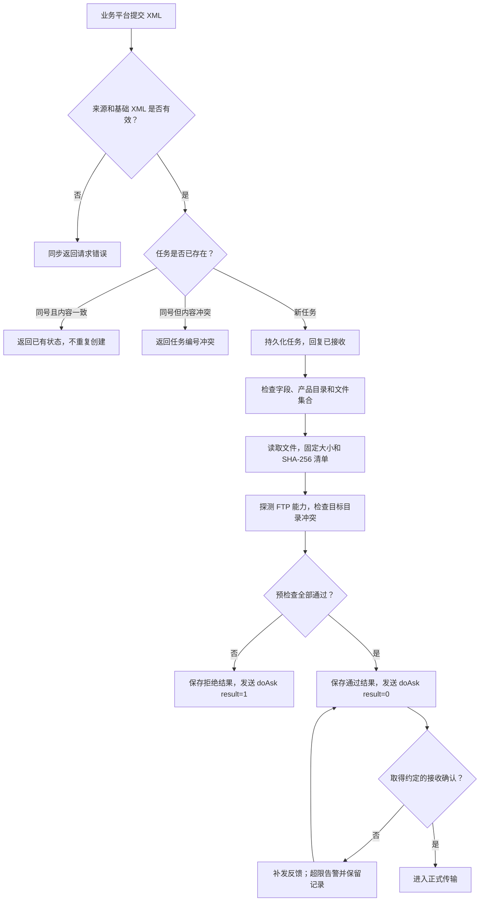
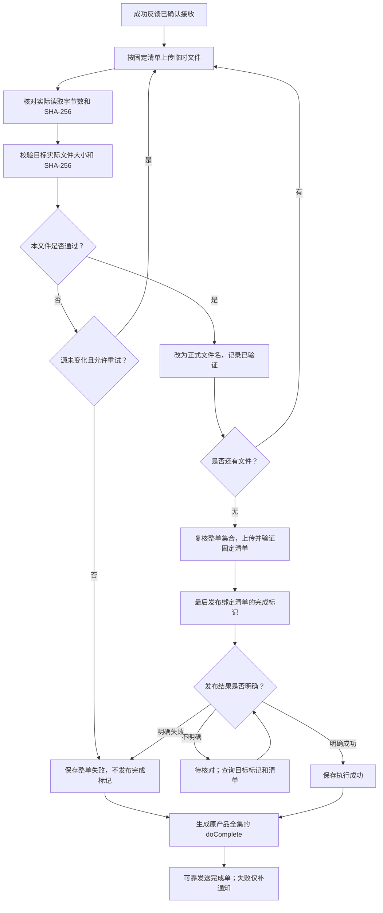

# 数据共享平台：推送流程

| 文档信息 | 内容 |
| --- | --- |
| 版本 | V1.0 |
| 日期 | 2026-11-13 |
| 状态 | 设计稿；新增对接规则需在双方联调中落定 |
| 适用范围 | 业务平台下发 XML 任务，共享平台将本地产品推送到指定 FTP |
| 配套文档 | [拉取流程](02_拉取流程.md)、[边界约定](03_边界约定.md) |

## 1. 目标、依据与保证范围

共享平台接收任务后，检查请求、源产品和目标链路，生成固定的传输清单；逐文件上传并核对目标实际内容；全部产品通过后发布整单成果，向业务平台发送完成单。

本文以用户提供的《2.1 调度系统与数据云共享子系统接口设计》为依据。其中，任务通知单、`doAsk`、`doComplete` 以及原有 XML 字段和状态来自原接口文档。产品目录含义、路由规则、传输清单、目标校验、完成标记、重试及 ACK 规则属于本次补充设计，不能当作对方已经支持的既有能力。

**本方案保证：在生产方固定源版本、目标任务目录受控、接收方遵守发布规则的前提下，预检查固定的文件集合及目录结构完整交付，目标文件字节内容与固定基准一致。**

共享平台自行生成的是“传输清单”。没有生产方应交付清单或产品结构规则时，不能据此发现上游本来应生成却未生成的文件。影像内容、业务范围及其他业务质量由业务平台验收。

## 2. 首版数据与目录规则

| 项目 | 规则 | 来源 |
| --- | --- | --- |
| `product` | 一个节点代表一个数据包 | 原接口 |
| 产品实体 | 首版统一为一个产品目录；单个 ZIP、TIFF 等文件也放在产品目录内 | 补充规则 |
| `fileCount` | 产品包数量，必须等于本任务 `product` 节点数量 | 原接口的包级计数口径 |
| `productPath` | 任务通知单中表示产品目录相对于源数据根目录的路径 | 补充规则 |
| `productName` | 产品显示名称，不参与文件路径拼接 | 补充规则 |
| 推送范围 | 递归纳入产品目录中的普通文件，记录并保留目录结构；符号链接和特殊文件拒绝接收 | 补充规则 |
| 源数据就绪 | 下发任务代表生产方确认该版本已生成完成；任务处理期间不得增删、修改这一版源数据 | 补充规则 |
| 配置选择 | 通过已鉴权的来源系统及产品 `type` 唯一匹配路由配置 | 补充规则 |
| 目标隔离 | 使用独立任务目录，避免不同任务相互覆盖 | 补充规则 |
| 数据处理 | 按复制交付，源数据保留；源数据清理另行约定 | 补充规则 |

### 2.1 路径映射

| 对象 | 组成 |
| --- | --- |
| 实际源产品目录 | `sourceRoot + productPath` |
| 目标任务目录 | `targetRoot/sourceCode/taskId/` |
| 目标产品目录 | `targetRoot/sourceCode/taskId/productId/` |
| 目标业务文件 | `targetRoot/sourceCode/taskId/productId/relativePath` |
| 目标传输清单 | `targetRoot/sourceCode/taskId/_manifest.xml` |
| 目标完成标记 | `targetRoot/sourceCode/taskId/_READY` |

`relativePath` 相对于源产品目录。控制文件放在任务根目录，与产品目录分开，防止控制文件和业务文件重名。用于路径的各标识必须经过安全字符验证或稳定、无碰撞的编码，保存编码前后映射，不能随意截断标识。

完成单中的 `productPath` 建议返回已分配目标产品目录相对于 `targetRoot` 的路径，即 `sourceCode/taskId/productId/`。失败完成单中的路径只用于定位和诊断，不表示该目录的数据可消费。此含义属于新增对接约定。

### 2.2 路由与源版本固定

任务保存本次源根目录、目标地址、目标根目录、校验方式和配置版本。执行中不跟随其他路由配置改变目的地。凭据使用受控引用，不将密码写入清单或日志。

源冻结首先是生产方的交付承诺；共享平台通过目录复查、文件属性检查、上传读取哈希来发现变化。稳定一段时间、文件能够打开或取得某种文件锁，都不能单独证明生产结束。生产方无法保证冻结时，应先提供独立的固定版本交付目录。

## 3. 预检查流程图



预检查发现错误时可以提前结束，不必继续执行图中的剩余检查。探测文件只写入本任务专用探测位置，不作为业务成果交付。

## 4. 接收与预检查的详细步骤

### 4.1 请求接入和幂等处理

| 步骤 | 检查内容 | 方法 | 不通过时的处理 |
| --- | --- | --- | --- |
| 1 | 来源及基本报文 | 鉴权；限制请求大小；安全解析 XML，禁用外部实体；识别根节点、`taskId`、`type` | 无法识别有效任务时同步返回明确请求错误 |
| 2 | 重复任务 | 使用“来源系统＋taskId”唯一键；比较解析后的业务内容，忽略不影响语义的格式差异 | 相同内容返回已有状态；不同内容返回冲突 |
| 3 | 任务保存 | 保存原始 XML、业务字段、来源及接收时间；数据库唯一约束防止并发重复创建 | 保存失败不返回接收成功 |
| 4 | 接收响应 | 持久化成功后立即响应“已接收”；文件检查和上传后台执行 | 后台进度通过任务记录查询 |

建议新任务返回 HTTP 202。该响应仅表示任务已经进入处理流程，不能表示文件校验通过或上传完成。相同任务重复请求不会重新扫描生成一份替代清单。

### 4.2 任务与源数据检查

| 步骤 | 检查内容 | 方法 | 不通过时的处理 |
| --- | --- | --- | --- |
| 5 | 必填字段和数量 | 检查原接口必填项；`createTime` 按约定格式解析；`fileCount` 为正整数且等于产品节点数；产品 ID 满足原文 32 位字符串要求且任务内唯一 | 记录字段或数量错误 |
| 6 | 唯一路由 | 通过来源系统与 `type` 查找一条启用配置并固定本次参数 | 缺失或匹配多条均拒绝，不猜选目的地 |
| 7 | 路径合法性 | 规范化并解析真实路径；确认仍位于允许源根目录；确认产品目录存在；检查重复或相互包含的产品目录 | 越界、目录缺失、范围重叠均拒绝 |
| 8 | 可传输文件集合 | 递归枚举目录、普通文件；拒绝符号链接和特殊文件；产品不得为空；检查目标映射是否有重名或大小写冲突 | 明确定位产品和文件 |
| 9 | 文件就绪和可读性 | 实际打开并读取文件；按约定的保留后缀识别 `.part`、`.tmp` 等未完成文件；已有产品结构规则时核对必需项 | 未就绪、不可读、缺必需项时拒绝 |
| 10 | 大小与 SHA-256 | 分块完整读取每个文件，统计字节数并计算 SHA-256；记录读取前后源属性 | 读失败、实际长度异常或读取期间变化时拒绝 |
| 11 | 目录一致性复查 | 完成全部读取后再次枚举，对比目录和文件集合以及源属性 | 有新增、删除、替换或修改时拒绝本轮预检查 |
| 12 | 固定传输清单 | 将目录结构、文件相对路径、大小、哈希及清单摘要持久化，与任务和路由绑定 | 保存失败不得进入可执行状态 |

补充说明：

- `fileCount` 只校验产品包数量；物理文件数量另行记录，不能混用。
- 不按扩展名猜测哪些文件应该传输。明确排除的控制文件必须配置并记录，不能临时忽略异常文件来凑齐结果。
- 零字节文件是否允许由产品规则明确。允许时仍记录 `size=0` 和对应哈希，不能跳过校验；禁止时返回明确原因。
- 若生产方提供应交付清单，或该 `type` 有固定组成规则，可增加缺项检查。共享平台自行枚举生成的传输清单不替代生产方应交付清单。
- 哈希计算使用分块读取，内存占用受控；无需把大文件一次装入内存。[NIST 哈希标准](https://csrc.nist.gov/pubs/fips/180-4/upd1/final)说明摘要可用于检测内容是否发生变化。

### 4.3 FTP 与目标位置检查

| 步骤 | 检查内容 | 方法 | 不通过时的处理 |
| --- | --- | --- | --- |
| 13 | FTP 控制连接 | 使用配置地址和账号连接、登录，核对目标根目录 | 连接、认证、目录访问失败时返回对应原因 |
| 14 | 实际数据通道 | 在专用探测目录上传非空小文件，等待完成响应；使用本任务所需模式 | 数据连接或写入失败时拒绝 |
| 15 | 校验能力 | 探测实际可用的大小与 SHA-256 查询能力；无法直接校验时探测完整读取能力 | 不具备任何严格校验路径时拒绝，不自动降级 |
| 16 | 文件操作能力 | 核对探测文件，测试同目录重命名，清理探测文件及目录 | 需要的操作不被允许时拒绝 |
| 17 | 目标冲突 | 检查任务目录和已有清单；区分原任务残留、原任务已发布、其他内容 | 不覆盖不属于本任务或与固定清单冲突的内容 |
| 18 | 存储条件 | 服务器能提供配额或空间时与任务大小比较；不能查询时记录未知 | 已知空间不足时拒绝；未知不伪装为容量检查通过 |

FTP 的控制连接和数据连接分开，登录成功不能覆盖实际上传能力；见 [RFC 959](https://www.rfc-editor.org/rfc/rfc959.html)。小文件探测也不能证明大任务一定有足够容量，执行中仍需处理空间不足。

严格校验只接受以下两条可行路径之一：

1. 取得目标文件准确大小和远端实际 SHA-256，再与固定清单比较。
2. 完整读取目标实际文件，统计字节数并在共享平台计算 SHA-256。

远端哈希依赖服务器扩展支持，接入时必须实测，见 [WinSCP 官方校验能力说明](https://winscp.net/eng/docs/ui_properties)。只有写权限、没有上述验证能力的 FTP，不满足本版严格推送接入条件。

### 4.4 反馈预检查结果

预检查全部通过后，在同一数据库事务中保存可执行状态和 `doAsk result=0` 待发送记录。失败时保存拒绝状态及 `doAsk result=1` 记录，使用原字段 `rejectrason` 返回原因。

`result=0` 表示预检查通过、允许进入执行；不精确表示已经发送了文件字节。真正的开始时间由内部执行状态记录。

本版约定：取得业务平台对成功反馈的接收确认后才开始传输。确认应表示该消息已按任务号和单据类型持久化接收；具体响应 XML 结构、成功字段和重发响应须联调确定。普通 HTTP 成功响应只有在双方约定其等价于该接收确认时，才能作为通知送达依据。

前置检查拒绝的任务默认通过失败反馈单结束，不再发送完成单。若调度系统要求所有任务另有终态上报，应补充协议后实施，避免同时发送含义冲突的单据。

## 5. 传输与发布流程图



任何阶段的非可重试错误均进入失败处理。待核对有超时和告警，不在工作线程中无限等待；未查明发布结果前，不贸然上报失败或重新覆盖成果。

## 6. 正式执行步骤与完整性判据

### 6.1 上传前复核与临时文件

执行器通过数据库原子领取任务，避免同一任务并发执行。再次核对本次固定源版本、目录集合和任务状态。按固定清单创建目标目录，业务文件先写入临时名称，如 `images/a.tif.part`。所有传输使用二进制模式。

目标任务目录在 `_READY` 生效前均为待发布数据，接收方不能提前消费。该目录由共享平台写入，接收方在发布前不修改内容，发布后也不能通过其他任务覆盖已有成果。

### 6.2 核对上传读取内容

上传时对实际读取的数据流统计字节数并计算 SHA-256。每个文件必须满足：

```text
实际读取字节数 = 固定清单中的大小
实际读取 SHA-256 = 固定清单中的 SHA-256
```

出现不一致时，说明源内容已偏离本任务基准。停止该产品，保留原因，不能修改清单来适应新文件后继续宣告原任务成功。

### 6.3 校验目标实际内容

上传命令完成不等于目标内容已经核验。按预检确认的能力执行：

- 远端校验：在上传完成、服务器关闭本次写入后，取得该目标文件的准确大小与 SHA-256。
- 全量回读：读取目标实际文件直至正常结束，统计字节数并计算哈希；无需保存另一个完整本地副本。

所有文件均须满足：

```text
清单大小 = 上传读取字节数 = 目标实际字节数
清单 SHA-256 = 上传读取 SHA-256 = 目标实际内容 SHA-256
```

读取上传到 FTP 的哈希文本或清单文本，不能替代对目标数据文件本身的验证。回读会额外产生一次完整下载流量，应在链路容量和任务耗时配置中考虑。

`SIZE` 的语义受传输类型影响，大小核对需保持一致的二进制设置，见 [RFC 3659](https://www.rfc-editor.org/rfc/rfc3659.html)。不支持可靠大小查询时，通过全量回读取得实际字节数。

### 6.4 单文件确认与整单复核

目标临时文件通过核验后改为正式文件名，确认目标路径和大小，保存文件完成记录。重命名失败或结果不明时先核对目标状态，不创建新的任务或覆盖其他数据。

全部文件处理后核对：

1. 原任务的每个产品均有完整处理记录。
2. 清单中的业务文件均位于正确目标相对路径。
3. 每个文件均有通过的大小、哈希核验记录。
4. 目标产品目录结构与清单一致。
5. 业务文件集合与清单一致，不包含遗留临时文件；协议控制文件单独核对。
6. 没有未验证、跳过或失败的必需文件。

任一项不满足，不能进入成功发布。

### 6.5 发布清单和完成标记

`_manifest.xml` 由共享平台从固定清单生成，至少包含任务标识、产品映射、目录结构、逐文件相对路径、大小和 SHA-256。固定生成后的内容字节及摘要，重试时不重新生成含不同时间或内容的替代清单。

发布顺序：

1. 全部业务文件上传、核验完成。
2. 上传 `_manifest.xml` 的临时文件，验证内容后发布正式名称。
3. 生成包含 `taskId`、清单摘要、产品数等关联信息的完成标记。
4. 先写临时标记，最后发布正式 `_READY`。
5. 核实目标标记内容与任务固定清单相符，记录发布成功。

接收方只消费存在有效 `_READY`、且其引用清单能够验证的任务。标记无法解析或清单摘要不符时，视为尚未有效发布。逐文件重命名本身不能提供整单发布保证，双方必须共同遵守此消费规则。

### 6.6 完成单和通知

执行结果与待发送完成单在同一数据库事务中保存。由通知执行器发送：

| 场景 | 完成单处理 |
| --- | --- |
| 全部核验并发布成功 | 整单 `status=0` |
| 执行最终失败且确认未有效发布 | 整单 `status=1` |
| 按明确协议作废删除 | 使用原文 `status=2`；不将其当作执行中或普通重试状态 |
| 发布结果未知 | 进入待核对，查明前不发送自相矛盾的成功或失败完成单 |

完成单始终保留原任务全部产品，`fileCount` 保持原产品数。成功产品可保留实际执行结果，失败产品填写原因，未执行产品标记失败并说明“因同任务失败未执行”。整单为 1 或 2 时，业务平台按原文要求将全单成果视为无效；单产品状态不覆盖整单语义。

完成通知超时只补发同一完成单。已经发布成功的数据不因通知失败重新上传，不把通知失败改写成传输失败。

## 7. 状态、幂等和故障恢复

### 7.1 分开保存状态

| 维度 | 主要状态 | 说明 |
| --- | --- | --- |
| 任务执行 | 已接收、预检查中、待执行、执行中、发布中、执行成功、执行失败、已拒绝、待核对 | 执行成功不等于完成通知已经送达 |
| 产品处理 | 待检查、检查通过、传输中、目标已验证、失败、未执行 | 产品验证通过仍需等待整单发布 |
| 通知 | 待发送、发送中、已确认接收、待重试、待处理 | `doAsk` 和 `doComplete` 各有独立记录 |

推送流程闭环由执行终态和相应通知确认共同确定。状态变化应有前置条件，迟到通知和重复请求不能把终态回退。

### 7.2 重试规则

首版 `maxRetries=3`，表示首次尝试之外最多重试 3 次；间隔、连接超时和无数据进展超时可配置。长文件不能仅因一个不适合文件规模的固定总时长被误判。

| 异常 | 处理 |
| --- | --- |
| 临时网络或 FTP 错误 | 以受影响文件为单位重试 |
| 本任务已有完整目标文件 | 与固定清单核验一致后复用 |
| 只有不确定的临时文件 | 首版从头重传该文件，不盲目追加 |
| 目标哈希不符 | 核实源仍符合固定基准，再有限重传 |
| 源目录或内容变化 | 停止原任务；修复后作为新版本用新任务号交付 |
| 权限不足、路径错误、冲突 | 记录明确错误，等待修复，不盲目循环 |
| 回调超时 | 重发相同任务、相同单据类型和相同内容的通知 |
| 发布响应丢失 | 读取目标标记和清单，先确定是否已发布 |

通知重试超限后保留待处理记录并告警，不能删除通知或重传文件“补救”。同一任务号绑定一次固定内容；已经回报终态后，不自动改为执行另一版数据。

### 7.3 服务恢复

重启后从持久化状态恢复任务和通知：

- 固定清单与路由存在，源版本未变：检查目标已有成果，复用已核验文件，继续其余文件。
- 发现有效完成标记且与固定清单一致：恢复发布结果，补齐本地状态和完成通知。
- 目标标记不存在且状态可确定：按未发布任务继续核对。
- 发布结果无法确认：保持待核对，有限重查并告警。
- 已执行成功、只有通知未送达：只恢复通知发送。

## 8. 接口映射与联调事项

| 接口 | 提供方与调用方 | 本文使用方式 |
| --- | --- | --- |
| 任务通知单 | 共享平台提供，业务平台调用 | XML 创建推送任务；地址由共享平台提供 |
| 任务通知反馈单 | 业务平台提供，共享平台调用 | [doAsk](http://172.31.11.67:9000/restful/cloudyingyong/doAsk)，检查通过或拒绝 |
| 任务通知完成单 | 业务平台提供，共享平台调用 | [doComplete](http://172.31.11.67:9000/restful/cloudyingyong/doComplete)，执行最终结果 |

以上地址来自用户提供文档，本文没有对其可用性进行实测。

| 待落定事项 | 当前设计建议 |
| --- | --- |
| 完成单 `ProductList` 与 `productList` 重复定义 | 以实际样例和双方确认确定唯一结构，不同时输出两份列表 |
| 拒绝原因拼写 | 保持外部字段 `rejectrason`，内部可规范命名 |
| `productPath` | 请求为源产品目录相对路径，完成单为分配目标目录相对路径；写入补充协议 |
| ACK | 明确响应格式、任务关联、持久化接收语义和重复通知响应 |
| XML 提交方式 | 明确原始 XML 请求体还是文件上传，以及编码和内容类型 |
| 严格验证能力 | 实测远端大小和 SHA-256，或完整回读能力 |
| 消费规则 | 接收方只消费有效完成标记对应的整单，发布后不修改这一版成果 |
| 源冻结及保留后缀 | 明确下发即就绪，`.part`、`.tmp` 等规则与实际业务文件命名不冲突 |

## 9. 最小持久化与日志

任务至少保存：来源、任务号、原始业务内容摘要、原始 XML、路由快照、状态、阶段、开始结束时间、固定清单和摘要、发布结果、最后错误。

文件明细至少保存：产品 ID、源与目标相对路径、预期大小与哈希、实际读取及目标核验结果、核验方式、重试次数和错误。

通知至少保存：任务号、单据类型、固定报文、发送次数、下次处理时间、接收确认和最后错误。通知类型与任务号构成去重依据，接收方也应按相同语义幂等处理。

日志能定位到任务、产品、文件和失败阶段；错误原因通过 XML 返回时正确转义。日志与清单不记录账号密码等秘密。

## 10. 开发验收用例

| 用例 | 预期结果 |
| --- | --- |
| `fileCount` 与产品节点数不符 | 预检查拒绝，不传业务文件 |
| 相同任务重复提交 | 仅一条任务、一个执行流程，返回已有状态 |
| 相同任务号但内容不同 | 返回冲突，原任务不被覆盖 |
| 源路径越界、符号链接或产品路径重叠 | 预检查拒绝并定位原因 |
| 源文件不存在、不可读或存在未完成文件 | 返回具体产品和路径 |
| 枚举或计算清单期间源目录变化 | 本轮预检查失败 |
| 预检后修改内容但保持大小不变 | 上传读取哈希或目标哈希不符，不发布 |
| 目标文件大小正确但内容损坏 | 目标哈希校验失败 |
| FTP 能登录但数据通道不可用 | 实际探测失败，不能视为链路通过 |
| FTP 无远端哈希但可回读 | 使用实际文件全量回读完成核验 |
| FTP 只能写且无严格核验能力 | 预检查拒绝，不降级成功 |
| 多个产品中一个最终失败 | 整单失败，无有效完成标记，完成单保留全部产品 |
| 接收方扫描未发布任务目录 | 不消费其中任何业务成果 |
| 完成标记响应丢失 | 核对目标后恢复正确状态，不盲目失败或重复发布 |
| 发布后、本地成功记录前进程中断 | 通过固定清单与目标标记恢复成功状态 |
| 完成通知超时 | 数据不重复上传，仅补发通知 |

## 11. 参考依据

1. 用户提供的《2.1 调度系统与数据云共享子系统接口设计》，重点为 2.1.2、2.1.3、2.1.4；示例 XML 附件未提供，字段歧义仍需联调确认。
2. [RFC 959：File Transfer Protocol](https://www.rfc-editor.org/rfc/rfc959.html)，用于控制连接、数据连接及 FTP 文件操作能力说明。
3. [RFC 3659：Extensions to FTP](https://www.rfc-editor.org/rfc/rfc3659.html)，用于文件大小、修改时间及续传相关语义。
4. [WinSCP：Properties Dialog — Checksum](https://winscp.net/eng/docs/ui_properties)，用于远端校验需要服务器扩展支持的说明。
5. [NIST FIPS 180-4：Secure Hash Standard](https://csrc.nist.gov/pubs/fips/180-4/upd1/final)，用于哈希摘要校验依据。
