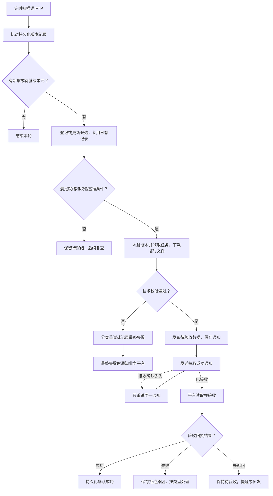

# 数据共享平台——拉取流程设计

| 项目 | 内容 |
|---|---|
| 文档版本 | V1.0 |
| 编制日期 | 2026-11-13 |
| 文档状态 | 设计稿；新增接口及双方配合规则需在联调中确认 |
| 适用范围 | 定时扫描外部 FTP，发现并下载新数据，通知业务平台，接收最终验收结果 |
| 关联文档 | [01_推送流程.md](01_推送流程.md)、[03_边界约定.md](03_边界约定.md) |

## 1. 需求依据与成功标准

用户提出的拉取需求为：定时扫描指定 FTP，发现新文件后检查是否完整，开始拉取；拉取完成后通知业务平台；业务平台检查数据完整性，并返回确认成功或失败。

据此，将一次拉取分成三个需要独立记录的结果：

1. **传输结果**：数据是否已下载到本地，并通过约定的技术检查。
2. **通知结果**：业务平台是否明确确认收到这次结果通知。
3. **验收结果**：业务平台是否明确确认该次交付的数据验收成功。

**拉取最终成功＝本次交付通过技术检查＋业务平台返回有效的验收成功回执。**

下载完成时记录“待平台验收”。通知超时、平台尚未验收、平台明确拒绝，应分别处理。HTTP 接收确认不能代替业务验收结果。

本文件中的数据单元划分、扫描参数、状态、接口路径和新增字段均为建议设计。用户提供的原接口文档主要描述推送任务，本文件不将新增拉取接口表述为原文已有接口。

## 2. 各方职责

| 参与方 | 责任 |
|---|---|
| 源数据提供方 | 生成产品数据，说明数据单元边界和源端就绪规则；按双方约定提供稳定版本、清单、完成标记或校验信息 |
| 源 FTP 管理方 | 提供访问地址、账号、读取权限和目录范围，维护 FTP 服务 |
| 共享平台 | 定时扫描、登记版本、避免重复任务、执行拉取前检查、下载和技术校验、管理落地数据、通知平台并处理回执 |
| 业务平台 | 提供通知接口和可访问的数据交接方式；读取待验收数据，检查业务完整性并返回明确结果及失败原因 |

共享平台仍须执行拉取前、拉取后的检查。源端负责生产完整性，业务平台负责最终业务验收，不能用其中一项替代另外两项。

源端没有预期清单时，共享平台能够固定和核对观察到的文件集合，无法凭现有目录推断上游原本应生成却遗漏的文件。影像区域、业务内容、产品是否满足需求等，由业务平台验收。

## 3. 数据单元与目录约定

### 3.1 每个来源配置固定一种模式

| 模式 | 一个数据单元是什么 | 处理范围 |
|---|---|---|
| `FILE` | 一个普通文件 | 文件内容本身；压缩包默认按一个文件传输，不自动解压 |
| `PACKAGE_DIR` | 一个产品目录 | 按配置的产品目录层级识别数据包，递归读取该目录内约定的业务文件并保留相对结构 |

一个来源配置只能选择一种模式，不能根据文件名临时猜测“这是独立文件还是产品包”。同一 FTP 可以建立多个来源配置，分别处理不同目录或不同数据形式。

目录包模式还需配置产品目录的识别层级。例如“扫描根目录的直接子目录各为一个产品”，应作为明确规则保存。目录本身的修改时间不能代替包内文件清单检查。

### 3.2 路径和文件范围

- 源路径统一记录为相对源根目录的路径；规范化后不得越出允许的根目录。
- 首版拒绝符号链接和特殊文件，避免意外扩展扫描范围。
- 完成标记、清单等控制文件按明确配置处理；不能混入业务文件数量。
- 临时名规则由双方约定，不能随意过滤某种后缀而漏掉合法业务文件。
- 同一文件名的不同版本保存到不同交付目录，避免覆盖已提交验收的数据。

建议本地布局为：

| 区域 | 建议路径 | 使用规则 |
|---|---|---|
| 下载临时区 | `localRoot/tmp/transferId/` | 下载、续作检查及校验期间使用，业务平台不读取 |
| 待验收区 | `localRoot/pending/transferId/` | 技术检查通过后发布，验收期间路径与内容保持稳定 |
| 异常数据保留区 | `localRoot/rejected/transferId/` 或保持原目录并标记拒绝 | 保存失败证据，按处置规则隔离 |

`dataLocation` 必须是业务平台实际可访问的共享存储位置或约定下载地址。共享平台本机绝对路径与业务平台访问路径的映射要写入配置。未经约定，不在验收期间移动、覆盖或删除文件。

## 4. 来源配置

| 配置项 | 含义与建议 |
|---|---|
| `sourceId` | 稳定的来源配置标识 |
| FTP 连接配置 | 地址、端口、账号、协议和连接参数；日志不得输出口令 |
| 源根目录与扫描范围 | 明确目录、递归深度和允许的数据范围 |
| `unitType` | `FILE` 或 `PACKAGE_DIR` |
| 数据单元识别规则 | 文件匹配规则，或产品目录的层级与命名规则 |
| 扫描周期 | 建议初值每 1 分钟一次，可按数据规模和产出频率调整 |
| 就绪规则 | 正式清单、版本绑定的完成标记、发布改名，或兼容稳定性规则 |
| 稳定观察参数 | 建议初值连续 3 次有效扫描一致；另设最小观察时长，均可配置 |
| 校验模式 | `BASIC` 或 `HASH`；严格模式不能在缺少基准时自动降级 |
| 初次扫描模式 | 默认 `IMPORT_EXISTING`；也可明确选择 `BASELINE_ONLY` |
| 本地落地与访问映射 | 临时目录、待验收目录、业务平台可访问位置 |
| 并发与超时 | 同时下载数量、连接超时、无数据进展超时、任务等待期限 |
| 重试规则 | 建议每文件在首次尝试之外最多重试 3 次，即最多 4 次尝试；间隔可配置 |
| 通知和验收配置 | 通知地址、鉴权、回执约定、验收超时和提醒策略 |
| 数据保留策略 | 无明确清理约定时保留源文件和已交付数据 |

扫描周期和连续观察次数只是初始配置，不能被解释为“超过这些时间就能严格证明源文件完整”。扫描失败或目录信息不完整的轮次，不计入连续稳定次数。

初次扫描默认处理当前范围内尚未登记的数据。选择 `BASELINE_ONLY` 时，只将首次看到的数据登记为历史基线，后续处理新增版本；必须保存该选择、初始化时间及基线范围，避免静默忽略历史数据。

## 5. 主流程图

图中的通知接收确认只是常规顺序。若通知 ACK 丢失，但平台已经处理并回传有效验收结果，共享平台应接收该结果，不得要求先补齐 ACK 才能确认成功。

## 6. 逐步处理方法

### 第 1 步：连接并列举源目录

按来源配置连接 FTP，使用约定的二进制传输方式和数据连接设置，读取允许范围内的目录信息。优先使用服务器支持的机器可读目录信息；具体能力在接入时验证。

扫描必须能区分普通文件、目录和不可处理对象。完整记录扫描是否成功；目录列表超时、权限错误或部分目录读取失败，不应当被当成“这些文件已经不存在”。

失败时记录来源、失败目录和错误原因，按扫描重试规则处理，不为每一次扫描故障创建新的文件交付任务。

### 第 2 步：识别数据单元与源版本

先按照 `unitType` 和路径规则形成文件或产品包，读取候选版本信息。待就绪观察允许更新候选；在满足就绪和校验基准条件、创建交付记录之前，才固定用于本轮交付的 `sourceVersion`。

| 版本依据 | 使用方式 | 能力边界 |
|---|---|---|
| 源端明确版本号 | `sourceId + sourcePath + sourceVersion` | 源端须保证同版本内容不变 |
| 与已发布数据绑定的可信清单摘要 | 以清单摘要作为版本依据或与版本号共同使用 | 清单须明确对应的数据范围 |
| 大小与修改时间 | 文件使用大小、修改时间组合；目录包使用规范化文件列表及各文件属性组合 | 属于弱版本识别，不能识别所有同大小、同时间覆盖 |

FTP 的修改时间与大小有助于识别变化和判断能否安全续作，但目录列举中的大小信息可能需要用更准确的 `SIZE` 或实际读取结果复核，具体受服务器能力和传输类型影响。[RFC 3659](https://www.rfc-editor.org/rfc/rfc3659.html)

稳定性观察优先比较同一源端返回的前后属性，观察时长使用共享平台本地记录，避免直接假定两端时钟完全一致。

### 第 3 步：登记发现记录并去重

发现数据单元时立即持久化候选观察，不能等平台验收成功后再登记。待就绪阶段，以 `sourceId + sourcePath` 关联当前候选；文件集合、大小或修改时间变化时，更新候选并重置连续稳定次数，不能为每轮变化都新建交付任务。

就绪后固定 `sourceVersion`，再以 `sourceId + sourcePath + sourceVersion` 对正式版本去重并关联交付。已冻结或已经交付的版本不原地修改；新的候选替代旧候选时结束旧观察，历史变化保留在日志中。候选记录和正式版本记录可以采用同一记录在不同阶段表达，不要求额外引入独立服务。

| 已有状态 | 本轮处理 |
|---|---|
| 无记录 | 建立候选观察，进入待就绪检查 |
| 等待就绪 | 复用同路径候选；属性变化时重置稳定次数，继续观察 |
| 待下载或下载中 | 复用当前任务，不再创建并行下载 |
| 已下载、通知待重试、等待验收 | 跳过下载，继续原通知或验收流程 |
| 已验收成功 | 跳过相同版本 |
| 传输失败或验收失败 | 按原记录的处置与重试规则处理 |
| 原路径出现新候选 | 观察并在就绪后冻结新版本，不能覆盖已冻结版本状态 |

来源配置发生影响数据边界的修改时，应使用新的配置版本并明确重扫规则，避免同一 `sourceId` 在不知情的情况下改变识别含义。

### 第 4 步：检查源数据是否就绪

优先使用源端明确提供的完成规则：

1. 数据生产完成后才发布的正式清单。
2. 与产品版本或清单绑定的完成标记。
3. 按协议从临时名称发布为正式名称。

清单存在不自动代表可用。应检查清单是否完整可解析，列出的文件是否存在，路径是否越界，产品版本及数量是否自洽；有大小信息时核对源端可获得的文件大小。清单或标记自身尚在写入、无法解析时，保持待就绪。

源端无法提供完成协议时，可以使用兼容稳定性规则：连续若干次有效扫描中，文件集合、大小和修改时间保持一致，且满足配置的最小观察时长。目录包必须观察包内集合及逐文件属性，不能只观察目录名或目录时间。

**稳定性检查只表示满足约定的拉取条件。上传暂停、源端保留修改时间等情况仍可能满足这一条件，它不能严格证明产品已经生产完整。**

超过等待期限时保留原因并告警。是否向平台上报“源数据长期未就绪”，应作为来源级规则明确，避免每轮扫描重复报送同一问题。

### 第 5 步：确定本次校验方式并固定基准

| 模式 | 必需条件 | 拉取后可以报告的结果 |
|---|---|---|
| `BASIC` | 满足已约定就绪规则，可获得并核对传输字节数及源前后信息 | 基础技术检查通过，等待业务验收 |
| `HASH` | 具有绑定本次源版本的 SHA-256 基准，如源清单、校验文件或源服务器实际计算结果 | 大小及源基准哈希比对通过，等待业务验收 |

`HASH` 为严格配置时，缺少预期哈希、算法不支持或基准无法确定，任务保持不可执行并给出原因；不能静默改成 `BASIC`。

共享平台自己计算的本地 SHA-256 应保存为 `actualHash`，仅有这一值时，`expectedHash` 必须为空。不能把实际值复制成预期值，制造已经与源端比对的结果。哈希用于检测相对于已知基准的内容变化，其前提是存在明确的比较对象。[NIST FIPS 180-4](https://csrc.nist.gov/pubs/fips/180-4/upd1/final)

目录包没有生产方清单时，可以建立“观察到的传输文件集合”，用于防止本轮下载漏文件和混版本。它不等同于生产方的应交付清单。

### 第 6 步：创建交付记录并领取任务

对满足就绪及校验条件的候选固定 `sourceVersion`，按正式版本唯一键再次去重，然后创建当前交付轮次 `transferId`，保存来源配置快照、源版本、文件集合、预期大小和校验依据。

通过数据库唯一约束及原子状态更新领取任务，避免两个执行器同时下载同一版本。后台定时器恢复任务时，也必须遵循相同领取规则。

检查本地目录可写、剩余空间和配置的并发限制。目录包使用独立的 `transferId` 临时目录；文件使用临时名称，业务平台不读取该区域。

`transferId` 表示一轮交付，内部网络重试仍使用同一编号。若一次交付已经终结，或平台拒绝后经过修复重新交付，则生成新的 `transferId`，与原发现记录、原交付记录建立关联。

### 第 7 步：下载到临时区

按固定文件集合下载，不在执行中随意把新出现的文件加入本轮任务。记录每个文件实际读取的字节数、传输响应和进度。

首版可以按单文件重新下载处理未完成文件，已通过校验的文件在确认仍属于同一基准后可复用。若以后增加断点续传，必须先核对源版本；源信息变化时不能把旧片段与新内容拼接。RFC 3659 对源修改时间发生变化后继续恢复旧传输的风险有明确说明。[RFC 3659](https://www.rfc-editor.org/rfc/rfc3659.html)

连接断开、读取超时等临时错误按文件重试。源版本变化、文件集合变化或基准变化时，终止本轮基准的交付，标记原记录已变化或被替代，更新待就绪候选；重新满足就绪条件后再冻结新版本。

### 第 8 步：检查本地落盘结果

文件下载完并关闭后，至少检查：

1. 文件实际存在，且本地实际大小符合本次预期。
2. FTP 传输正常结束，实际字节数完整。
3. 按配置计算落盘文件 SHA-256；`HASH` 模式逐文件与源基准比较。
4. 目录包清单内文件全部到齐，目录结构符合固定集合。
5. 控制文件与业务文件数量分别计算，不混入 `actualFileCount`。
6. 有明确类型规则时执行约定的结构检查，如压缩包完整性测试；结果不替代业务验收。

对大文件分块读取计算哈希，避免一次加载整个文件。若在下载过程中先计算流摘要，它可以作为辅助信息；要求验证落盘文件时，仍以关闭后的实际文件读取结果为准。

发现大小或哈希不一致，保留诊断信息并按有限重试规则处理；未经验证的文件不进入待验收区。

### 第 9 步：复查源版本

下载校验后再次检查源版本、清单或文件集合，以及可获得的源属性。与固定基准不同，说明这一轮可能跨越了源更新过程，不能继续按原版本发布。

在只有弱版本信息的来源上，前后属性一致仍存在识别能力上限，应记录版本发现依据及其强弱。版本识别能力与内容校验等级分别记录：已经取得并比对源端哈希时，可以记录 `HASH`，同时注明发现去重依据较弱；没有源端内容基准时才记录 `BASIC`。需要严格版本保证时，应在接入约定中要求源端提供不可变版本或绑定版本的清单。

源端在旧版本已完整交付后发布新版本，应创建另一条发现记录。不同源版本可以独立验收，不能因为新版本到达而自动否定已交付的旧版本。

### 第 10 步：发布到待验收位置

全部技术检查通过后，将数据发布到对应 `transferId` 的待验收目录。优先在同一文件系统内完成目录发布；跨文件系统时，先完成目标位置的复制与检查，再使用明确完成标记，保证业务平台不会读取半成品。

记录 `dataLocation`、技术校验结果和“待验收”状态，并与待发送通知一起保存。采用可恢复的状态顺序：数据已就绪而通知尚未发出时，服务重启应能补发通知；通知不能指向未完成或不可访问的位置。

### 第 11 步：通知业务平台

共享平台发送本次拉取结果。成功结果包含可访问位置和技术检查信息；最终传输失败结果包含原因，失败通知不启动平台数据验收。

通知超时可能代表对方未收到，也可能代表对方已经收到但 ACK 丢失。应使用同一 `transferId` 和同一结果重发，由平台幂等接收。

普通 HTTP `202` 表示已接受处理而尚未完成，不应被解释成业务验收成功。[RFC 9110，第 15.3.3 节](https://www.rfc-editor.org/rfc/rfc9110.html#section-15.3.3)

### 第 12 步：接收平台验收结果

平台读取数据后返回成功或失败。共享平台校验来源身份、`transferId`、`sourceVersion` 与当前交付轮次关系，确认该交付已通过技术检查且已发布到待验收位置，持久化结果后再回复接收确认。传输失败、尚未就绪或未发布的交付收到成功验收回执时，记录协议冲突，不用回执覆盖原传输结果。

- 成功：记录验收成功，结束该轮拉取。
- 失败：记录原因和错误分类，决定重新交付、等待源端修复或转人工处理。
- 未收到结果：保持待验收，按规则提醒、补发同一通知或进行约定的状态核对，不自动认定成功或失败。

回执可以先于通知发送方收到 ACK 到达，只要它对应有效的当前交付，就正常处理。迟到保护指同一发现版本中被新交付轮次替代的旧 `transferId`；不同源版本的独立有效交付仍分别处理。

## 7. 新增接口建议

### 7.1 拉取结果通知

| 项目 | 建议 |
|---|---|
| 提供方 | 业务平台 |
| 调用方 | 共享平台 |
| 方法与路径 | `POST /api/sharing/pull/results` |
| 请求格式 | 建议 XML；最终请求体和编码在联调时确认 |
| 接收确认 | HTTP 200 或 202，加明确的接收结果和对应 `transferId` |
| 业务意义 | 接收一次成功或失败的拉取结果；成功结果随后进入平台验收 |

| 字段 | 说明 |
|---|---|
| `transferId` | 本轮交付唯一编号；普通通知重试保持不变 |
| `sourceId` | 来源配置标识 |
| `unitType` | `FILE` 或 `PACKAGE_DIR` |
| `sourcePath` | 源根目录下的数据单元相对路径 |
| `sourceVersion` | 本次源版本及其识别依据 |
| `actualFileCount` | 本次交付实际业务文件数量；不复用推送 XML 的产品包数 `fileCount` |
| `totalBytes` | 业务文件实际总字节数 |
| `verificationLevel` | 技术检查通过时填写 `BASIC` 或 `HASH`；未通过时不提供已通过等级 |
| `checksumAlgorithm` | 使用的算法，如 SHA-256；未使用时按协议为空 |
| `digestManifest` 或逐文件校验信息 | 文件相对路径、预期值是否存在、实际大小、实际哈希及比较结果；清单形式须可由平台读取 |
| `dataLocation` | 成功时的平台可访问位置；失败结果不得伪造有效交付位置 |
| `transferResult` | 建议 `0` 成功、`1` 最终失败 |
| `reason` | 失败原因或必要说明 |

成功通知提供完整的实际文件数量、总字节数、校验信息和有效数据位置。最终失败通知提供关联标识、`transferResult=1` 和具体 `reason`，不提供有效 `dataLocation` 或已通过的 `verificationLevel`，也不启动平台验收；未完成的校验统计只保留为内部诊断信息。

平台必须先持久化通知，再返回接收 ACK。相同 `transferId`、相同业务内容重复到达时返回已有接收结果；相同编号却内容不同应报告冲突，不覆盖旧记录。

### 7.2 拉取验收回执

| 项目 | 建议 |
|---|---|
| 提供方 | 共享平台 |
| 调用方 | 业务平台 |
| 方法与路径 | `POST /api/sharing/pull/confirmations` |
| 请求格式 | 建议 XML，与通知接口统一 |
| 必需字段 | `transferId`、`sourceVersion`、`acceptanceResult`；失败时提供 `reason` |
| 结果值 | 建议 `acceptanceResult=0` 为验收成功，`1` 为验收失败 |
| 受理前提 | 对应交付已通过技术检查并已发布待验收；不要求通知 ACK 已在共享平台落库 |
| 接收确认 | 共享平台持久化后返回接收结果，支持重复回执 |

建议增加结构化失败原因码，以区分暂时不可读、传输内容损坏、源数据业务不合格。若仅有自然语言 `reason`，默认保留失败并转人工判定，避免依靠字符串猜测后无限重传。

同一交付的最终验收结果应保持稳定。重复相同回执返回已接收；相互矛盾的最终结果记录冲突，不自动回退已确认状态。需要重新验收时，应通过明确的新交付轮次处理。

## 8. 状态与恢复规则

### 8.1 分开记录状态

| 维度 | 建议状态 |
|---|---|
| 发现与源就绪 | 待就绪、已就绪、源已变化、历史基线 |
| 传输 | 待下载、下载中、等待重试、技术检查通过、传输失败 |
| 通知 | 待发送、已确认接收、等待重试、待处理 |
| 验收 | 未开始、待验收、验收成功、验收失败 |

例如“技术检查通过＋通知等待重试＋待验收”是一种正常中间状态，不能合并成“拉取失败”。

### 8.2 错误分类

| 情况 | 默认处理 |
|---|---|
| 扫描连接失败 | 重试扫描并告警，不创建重复数据任务 |
| 源尚未就绪 | 更新原观察记录，后续复查 |
| 网络中断或临时读取错误 | 每文件有限重试，建议最多 3 次 |
| 本地大小或哈希不一致 | 核实源基准后有限重下，持续不符则失败 |
| 下载期间源版本变化 | 停止旧基准交付，识别新版本，不混合内容 |
| 通知未确认 | 只补发通知，不重新下载 |
| 平台验收超时 | 保持待验收并提醒，不自动关闭任务 |
| 平台暂时无法访问数据 | 先检查访问映射和服务可用性；按明确原因决定修复或新一轮交付 |
| 平台发现本地交付损坏 | 核实源版本后重新交付，使用新 `transferId` |
| 平台认为源数据业务不合格 | 等待源端修复或人工处理，不反复下载同一份坏数据 |

本文件中的“最多重试 3 次”均指首次尝试之外再重试 3 次，即最多 4 次尝试。文件重试、通知重试与验收等待分别计数和计时。达到自动处理上限后保留状态、原因及下一步责任方，进入待处理并提醒。

### 8.3 重启恢复与数据保留

- 服务启动后恢复待就绪、待下载、等待重试、待通知和待验收记录。
- 对中断的临时文件先核对源版本和已有记录，再决定复用或重下。
- 对已经落地且校验通过的数据继续发送原通知，不能因进程重启生成新 `transferId`。
- 若文件已发布但通知记录尚未完成，按确定的交付记录补齐通知；不能仅凭目录存在判断校验成功。
- 对当前交付的有效验收结果，先落库再 ACK；重复回执不产生重复业务处理。
- 默认不删除源 FTP 文件。源端清理须另有明确协议。
- 本地数据按约定保留策略管理。验收成功不自动意味着可以删除；需确认平台已复制数据或不再引用原路径。

## 9. 最小记录要求

| 记录 | 至少保存 |
|---|---|
| 来源与扫描 | `sourceId`、配置版本、扫描时间、范围、结果、失败目录 |
| 发现记录 | 数据单元路径、模式、当前候选属性、冻结后的版本、版本依据强弱、观察次数、首次和最近发现时间 |
| 交付记录 | `transferId`、关联发现记录、上轮交付、源配置快照、固定文件集合、当前状态 |
| 文件明细 | 相对路径、预期大小、实际大小、预期哈希及来源、实际哈希、校验方式、重试次数 |
| 通知记录 | 消息类型、完整请求内容、发送次数、最后响应、下次重试时间、接收确认 |
| 验收记录 | 回执原文、对应交付和源版本、结果、原因、接收时间、冲突信息 |

日志应能从 `transferId` 定位到源版本、具体文件、技术检查依据和平台回执。日志不记录 FTP 口令、接口密钥或包含敏感凭据的完整地址。

## 10. 验收用例

| 场景 | 预期行为 |
|---|---|
| 相同已冻结版本连续扫描多次 | 复用版本记录，最多一个当前交付任务 |
| 文件仍在写入，随后满足就绪规则 | 复用同路径候选，变化时重置稳定次数；就绪后冻结版本再下载 |
| 等待平台验收时再次扫描 | 不重复下载 |
| 文件同名但明确版本不同 | 创建独立版本和交付记录 |
| 文件大小、时间均未变但内容被覆盖 | 弱版本配置应明确无法保证识别；强版本接入应通过版本或清单变化识别 |
| 目录包内部少了清单声明的文件 | 保持未就绪或校验失败，不通知数据已可验收 |
| 严格模式缺少源哈希 | 阻止执行并报告基准缺失，不降级 |
| 无源哈希但基础检查通过 | 结果为 `BASIC`，预期哈希为空，继续等待业务验收 |
| 本地字节数正确但源哈希比对不一致 | 校验失败，按有限重试规则处理 |
| 下载期间源内容变化 | 不混合新旧版本，不发布旧基准的成功结果 |
| 数据已下载，但通知 ACK 丢失 | 用同一 `transferId` 补发通知，数据不重复下载 |
| 通知 ACK 丢失但验收成功回执先到 | 校验关联关系后正常确认成功 |
| 传输失败或未发布的交付收到验收成功回执 | 记录协议冲突，不改写传输结果 |
| 平台长期不回执 | 保持待验收，按期限提醒 |
| 平台拒绝后修复并重新交付 | 新建 `transferId`；上一轮迟到回执不覆盖新轮 |
| 同一来源新旧版本分别交付 | 两个版本独立验收，不能把旧版本有效回执误判为过期轮次 |
| 服务在下载或通知阶段重启 | 根据持久化记录恢复，不重复创建交付 |
| 首次配置选择仅建立历史基线 | 历史数据明确登记为基线，后续只处理新版本 |

## 11. 联调确认项

1. 每个来源采用文件模式还是目录包模式，产品目录如何识别。
2. 源端发布完成的规则，发布后是否保证同版本不再修改。
3. 是否提供产品清单、源哈希或远端校验能力，要求 `BASIC` 还是 `HASH`。
4. 初次扫描是否补拉历史数据，弱版本识别的能力边界是否被接受。
5. 业务平台访问路径、访问权限及验收期间的数据保留要求。
6. 两个新增接口的完整 XML 结构、鉴权、ACK、幂等键及失败原因码。
7. 验收期限、失败后的责任方和重新交付规则。
8. 源数据与本地数据的保留、归档和清理条件。

## 12. 参考资料

- 用户在本项目中提供的拉取业务流程与后续边界讨论。
- [RFC 3659：Extensions to FTP](https://www.rfc-editor.org/rfc/rfc3659.html)：目录信息、大小、修改时间及恢复传输相关语义。
- [RFC 9110：HTTP 202 Accepted](https://www.rfc-editor.org/rfc/rfc9110.html#section-15.3.3)：异步请求受理与最终处理结果的区别。
- [NIST FIPS 180-4：Secure Hash Standard](https://csrc.nist.gov/pubs/fips/180-4/upd1/final)：哈希摘要及内容变化检测。
